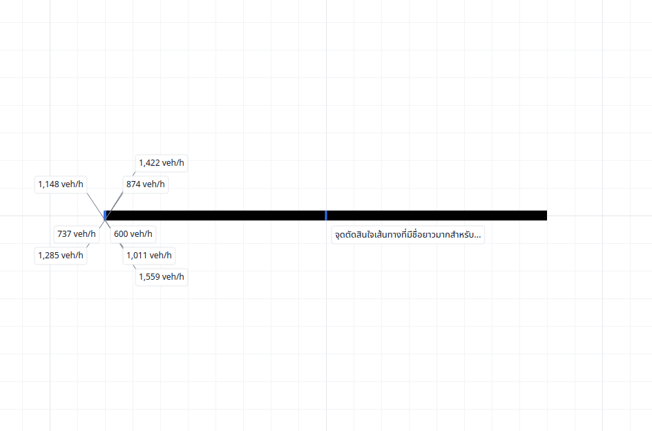
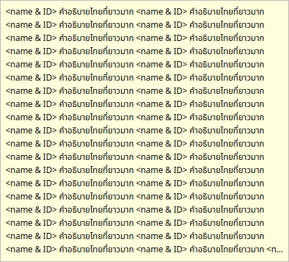
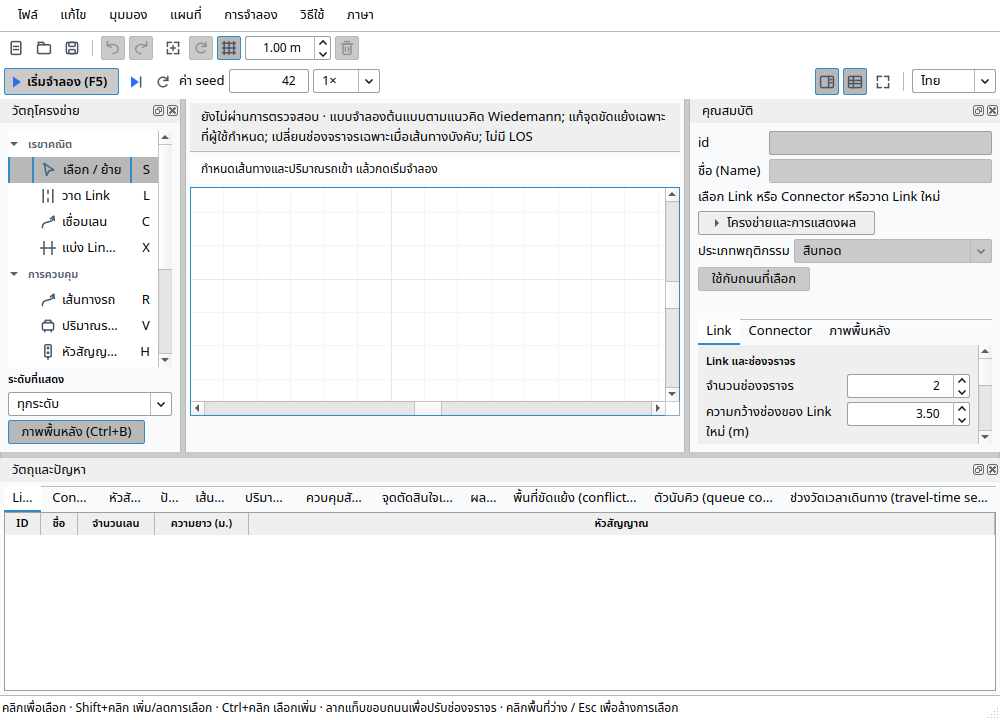

# GUI presentation verification — 2026-10-12

Contract: [GUI_PRESENTATION](../reference/GUI_PRESENTATION.md), rows GUI1–GUI8.
Base: `fcf0cf8bcbb63ee5c460dbe463c089f439475561` (main, PR #138).

The previous scratch workspace reset before it was pushed. This branch reconstructs
the eight-part implementation from the recorded design and verifies the actual
reconstructed sources; earlier local results are not substituted for these checks.

Toolchain: Ubuntu 24.04, GCC 13.3, Qt 6.4.2, PROJ 9.4.0, CMake 3.28.3 and Ninja 1.11.1.
Dependencies were downloaded from signed Ubuntu indexes, SHA-256 verified and
extracted into the workspace, without installing system packages. GUI uses `offscreen`.

## Checks

- `cmake --build --preset desktop --parallel 4`
- `cmake --build build/desktop --target check`
- New `gui-policy` and `gui-canvas` at 100%, 125%, 150%, 200%; the suites first assert
  that DPI/scroll/gesture forcing worked. Existing UI suites retain their assertions.
- Project marker cases: strict codec, old bytes, invalid-station rollback, History,
  shortening/deletion/split/reverse and exact simulation event/checkpoint/RNG replay.
- `cmake --install build/desktop --prefix ./out/gui-install` and installed `--version`.
- Native Linux/Windows workflow evidence is recorded on the draft PR.

Recovered-source desktop build passed. All 128/128 CTest tests passed (105.14 s),
including both new suites at all four DPI scales and the original model/UI regressions.
Architecture, file-size and documentation checks passed. Installation and installed
`TrafficSim 0.2.0` startup/version passed; desktop entry, SVG, eight PNG sizes and
seven ICO sizes were inspected. Native CI is pending on the draft PR.

The scratch filesystem dropped executable permission on one checker during the
initial target invocation. Restoring it and running the three checks plus complete
CTest passed; this was an environment issue, not a bypass or weakened assertion.

Physical Windows/multiple-monitor appearance review remains the owner's; no engine
or milestone validation gate is closed by offscreen screenshots or a CI build.
